<p align="center">
  
</p>

<h1 align="center">StashWiki</h1>

<p align="center">
  <b>A private, offline wiki builder for your worlds, characters and stories.</b><br>
  Fandom-style wiki pages, built visually — no account, no internet, no code needed.<br>
  For Windows and Mac.
</p>

<p align="center">
  <a href="https://github.com/dingspacedong/StashWiki/releases/latest"><b>⬇ Download the latest version</b></a>
</p>

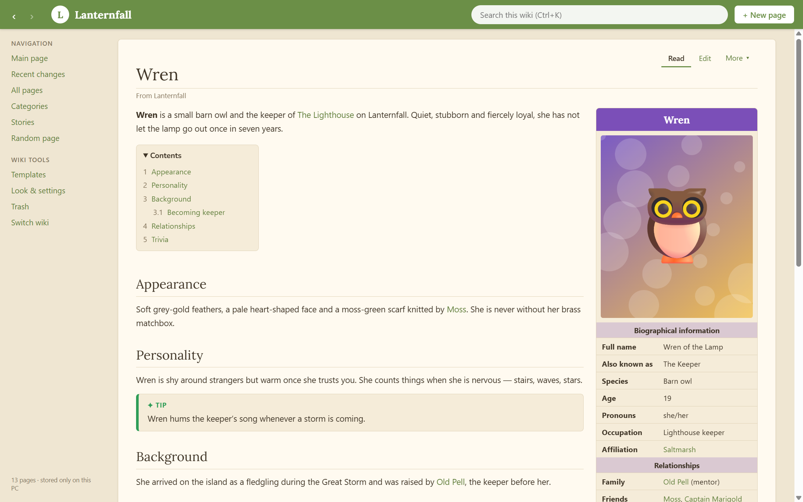

---

## Contents

- [Features](#features)
- [Screenshots](#screenshots)
- [Install](#install) — [Windows](#windows) · [Mac](#mac) · [From the source code](#from-the-source-code)
- [Updating](#updating)
- [Privacy](#privacy)
- [Credits](#credits)
- [License](#license)

## Features

### Wiki pages
- **Infobox templates** for Characters, Locations, Episodes, Movies and Games — or make your own. Drag fields to reorder them, and rename, add or remove fields on just one page.
- **Infobox picture tabs** (like *Card / Wish / In-Game*), **galleries** with captions, credits and a lightbox (mark single pictures or a whole gallery as spoilers), and pictures you can paste or drag straight in.
- **`[[Links]]` between pages**, with red links for pages that don't exist yet. Renaming a page updates every link to it.
- **Categories**, **search**, **recent changes**, **what links here**, **random page**.
- **Page history**: every page keeps earlier versions you can look at and restore. Deleted pages go to the **Trash**.
- An **introduction** above an automatic **contents box**, **notes at the top** ("For the pup, see …") and an **opening quote**.
- **Note, tip, warning and spoiler boxes** (spoilers stay blurred until clicked) and **page cards**: picture links to pages, like a character roster.

### Make it look like *your* wiki
- **Colors and fonts** for the whole wiki or a single page, a **background picture** (fill or tile), and a see-through **sidebar color**.
- **48 fonts built in**, including Google Fonts and **OpenDyslexic**. They work offline and go along when you share or export.
- **204 ready-made looks** you switch on with a click, with a live preview: 27 color themes (Cozy cottage, Night sky, Galaxy, Deep sea, Retro computer, Pirate map, Cherry blossom, Dragon’s hoard…), rounded or glowing infoboxes, fancy headings, patterned backgrounds, falling snow, confetti, floating hearts, emoji mouse pointers, rainbow titles and more.
- **64 fancy blocks** to insert into pages: banners, notices, navigation boxes, quote cards, chat bubbles, text-message phones, family trees, star ratings, stat bars, timelines, tabs, flip cards, fold-outs… Click their words to change them.
- A **sample page** with one of everything (infobox, boxes, cards, gallery, table…) to preview looks on, even before your wiki has pages that use them all.
- **Mix it up**: switch between several logos and color themes each time the wiki opens, on every page, or every time you save, like websites that look a little different on every visit. Exported websites switch too.
- **Custom CSS and HTML** for anyone who wants full control: for the whole wiki or one page, with a live preview. Scripts are always removed, so a wiki stays safe to share.

### Stories
- Write **fanfic and other stories** right inside your wiki, with chapters. Switch Stories off for any wiki that doesn't need them.
- A **Stories shelf** with covers, status, ratings and word counts, grouped into **series**.
- **Story pages** with a summary, tags, content warnings, characters and a chapter list you can drag into order.
- **Chapters that read like a book**: author's notes, previous/next, a reading-progress bar, and *Continue reading* that picks up where you stopped. Reading settings let you choose text size, font (including OpenDyslexic), spacing, width and Paper / Sepia / Night pages.
- **Writing** that saves by itself, with a live word count and a **Focus** mode. Mark chapters as **drafts** to keep them private.
- Character pages show the stories they **appear in**.

### Sharing and publishing
- **Export as a website**: a folder you can upload as-is to Neocities, Nekoweb or your own site. You choose whether it includes the wiki, the stories or both. Private pages are always left out.
- **Share files** (`.stashwiki`): the whole wiki in one file to send to a friend. Opening one you already have **merges** the changes, so you can work on a wiki together by passing it back and forth.

### Two ways to edit
- **Classic**: a full editor for each page, with an infobox form and a Save button.
- **Simple**: type straight onto the page as it looks when reading; it saves by itself, and the sidebar gets "+ Character"-style buttons. Switch between them any time in Look & settings.

### Optional AI writing buddy (off and hidden unless you turn it on)
- Brainstorms, writes and suggests changes as cards you **Apply** or **Undo**. Nothing changes until you say so.
- On stories: **Write with me** (it continues the scene in your style), **Suggest** (ideas, feedback, "does this fit my wiki?") and **Summarize** (chapter summaries and blurbs). Its "thinking" text never ends up in your writing.
- Works with NanoGPT, OpenRouter, Google Gemini, OpenAI, DeepSeek, Mistral, Groq, any OpenAI-compatible service, or a **model on your own computer** (LM Studio, Ollama, KoboldCpp, text-generation-webui, llama.cpp, Jan).
- Don't want AI at all? Download a **No-AI** version: the writing buddy isn't just hidden there, it isn't included at all.

## Screenshots

Every screenshot uses a different look, all built in.

| | |
|---|---|
| 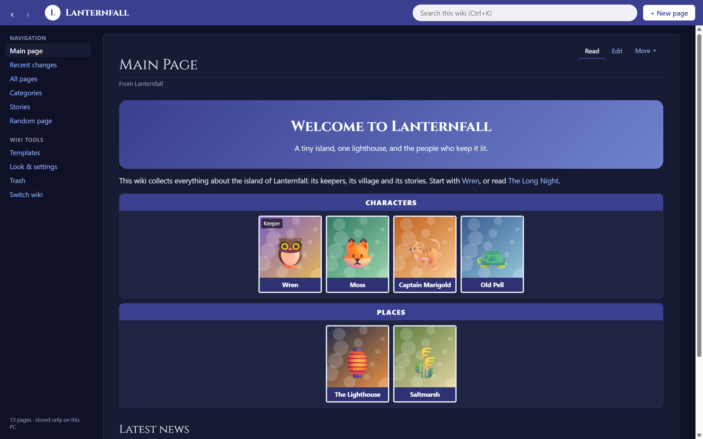<br>**Main page** with a fancy banner and page cards (*Night sky*) | 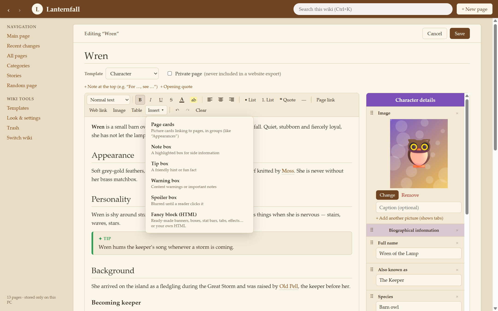<br>**Classic editor** and the Insert menu (*Parchment*) |
| 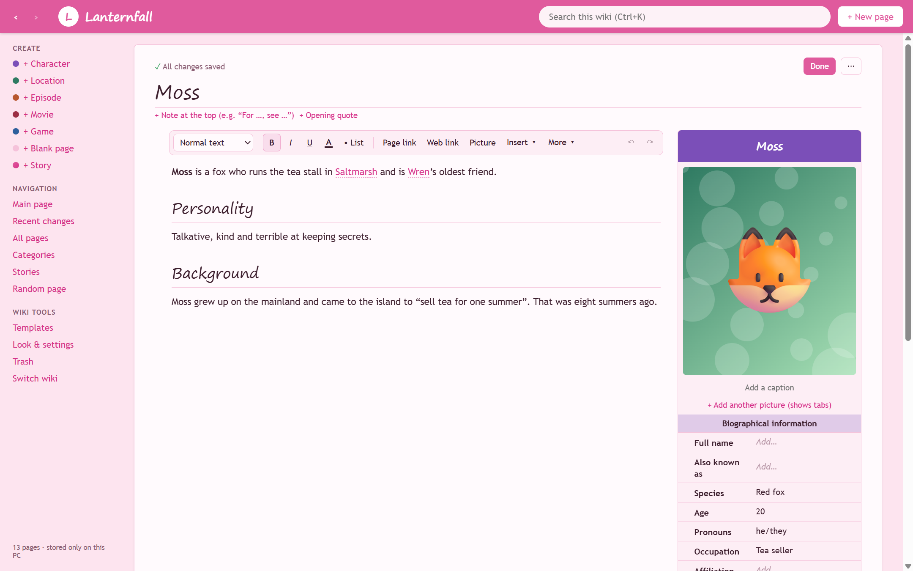<br>**Simple editing**: type straight onto the page (*Bubblegum*) | 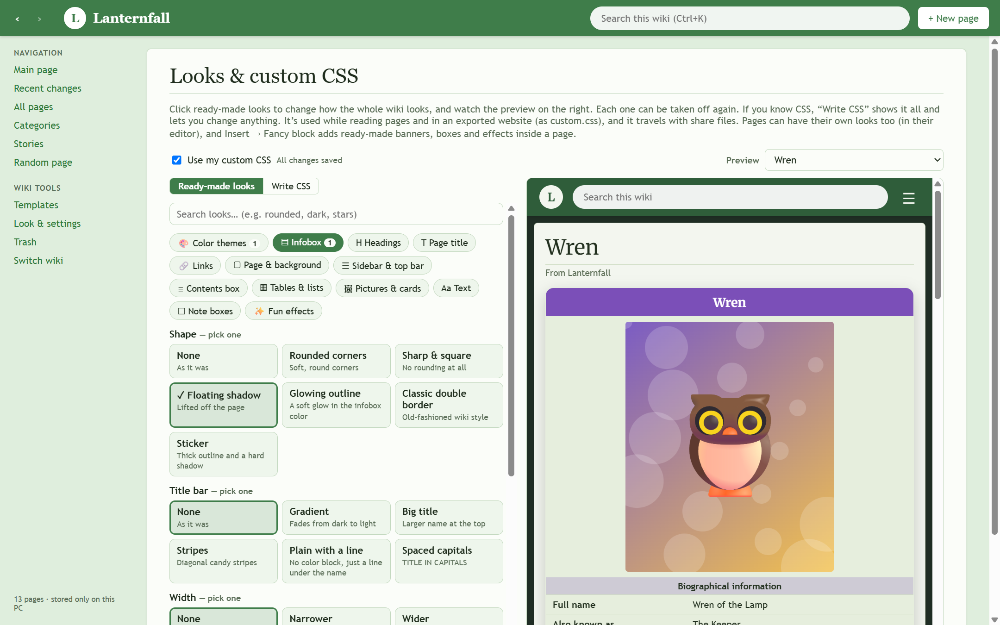<br>**Ready-made looks** with a live preview (*Meadow* + *Forest*) |
| 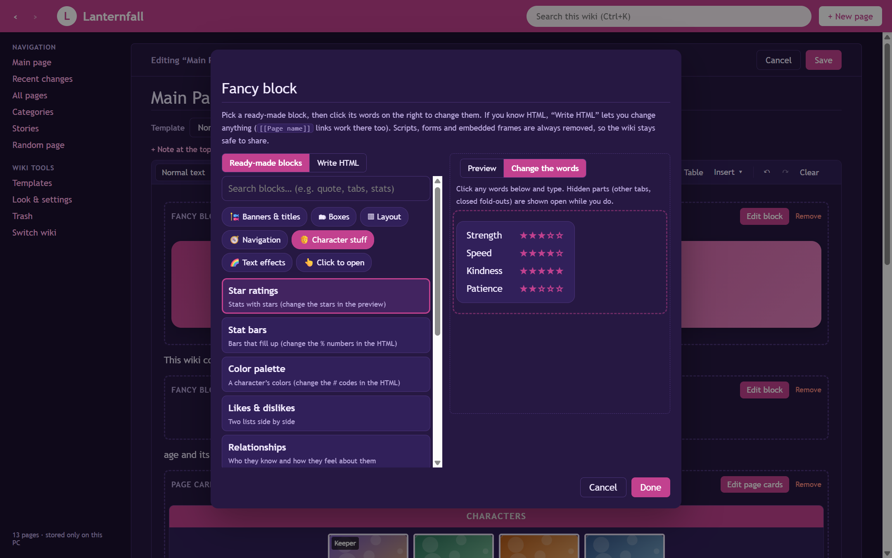<br>**Fancy blocks**: pick one, then change the words (*Starlight*) | 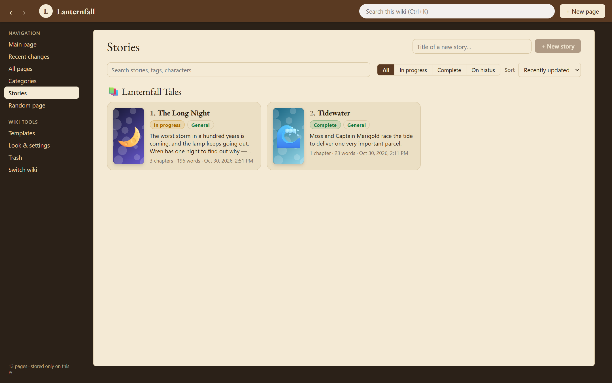<br>**Stories shelf** grouped by series (*Old library*) |
| 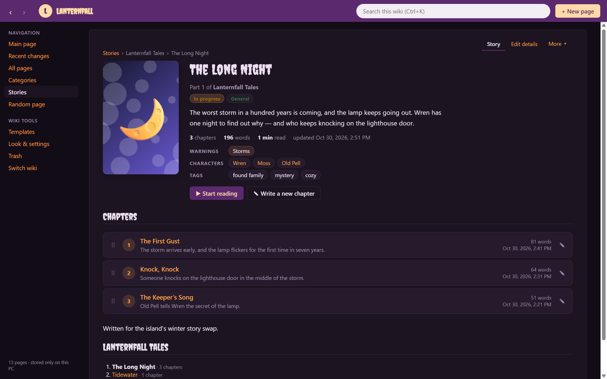<br>**Story page** with chapters, tags and characters (*Spooky*) | 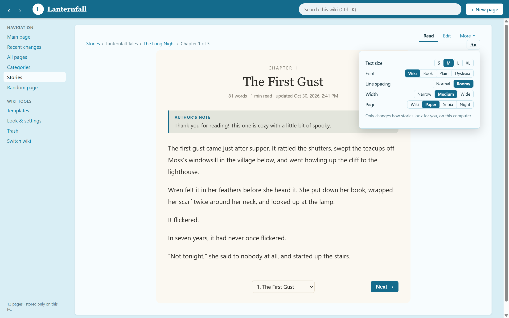<br>**Chapter reader** and reading settings (*Ocean* + Paper page) |
| 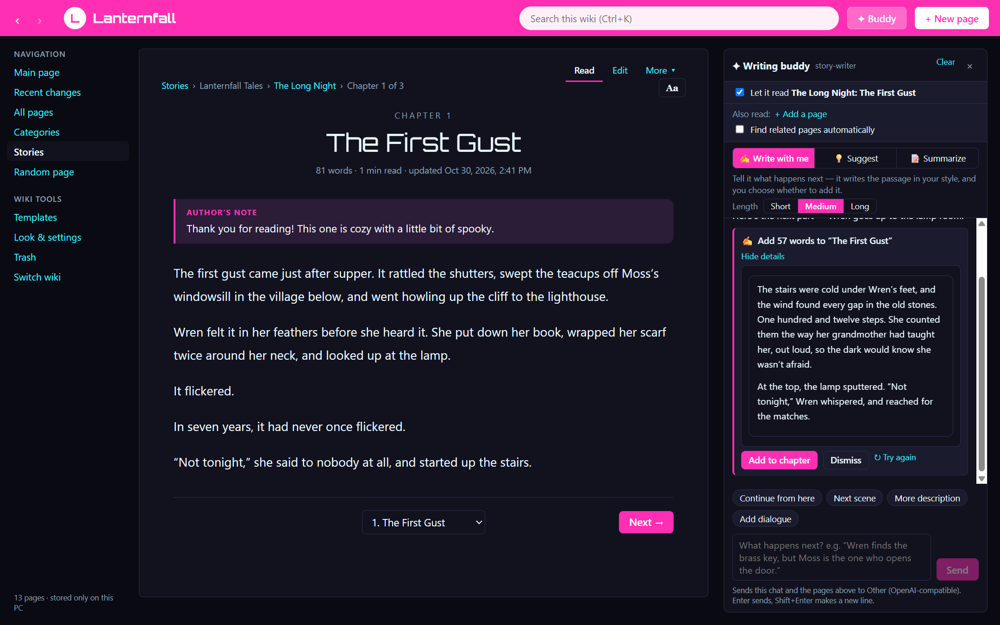<br>**Writing buddy**: write with me (*Neon arcade*) | 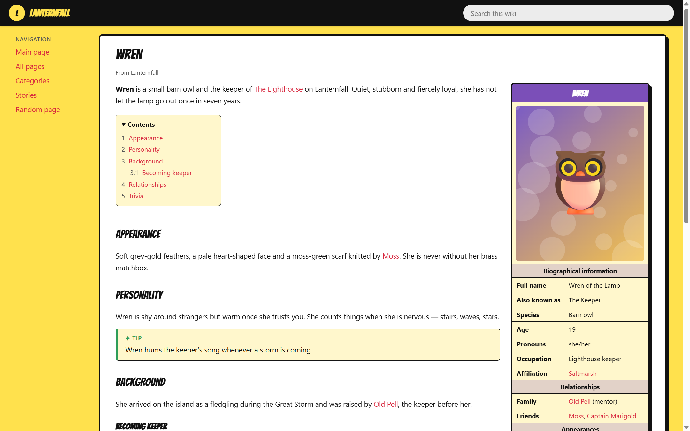<br>**Exported website**, ready to upload (*Comic book*) |
| 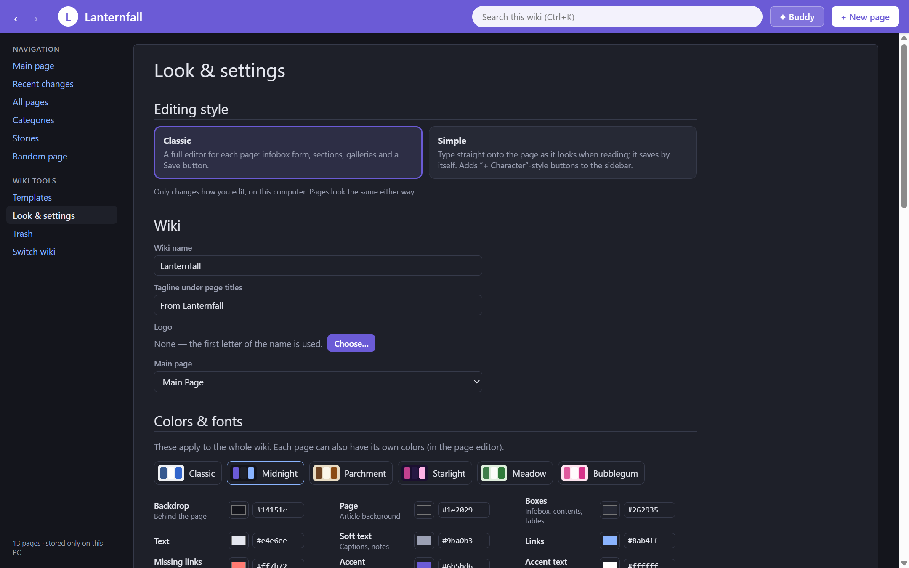<br>**Look & settings** (*Midnight*) | |

## Install

Download from the **[latest release](https://github.com/dingspacedong/StashWiki/releases/latest)**. You only need one file.

### Windows

| File | What it is |
|---|---|
| `StashWiki-Setup-x.y.z.exe` | **Recommended.** Installs StashWiki with a Start menu and desktop shortcut. |
| `StashWiki-Portable-x.y.z.exe` | Runs without installing, e.g. from a USB stick. |
| `StashWiki-NoAI-Setup-x.y.z.exe` | The installer without the AI writing buddy. |
| `StashWiki-NoAI-Portable-x.y.z.exe` | The no-AI version that runs without installing. |

StashWiki isn't signed with a paid certificate, so the first time Windows may say *"Windows protected your PC"*. Click **More info**, then **Run anyway**.

### Mac

Needs macOS 13 (Ventura) or newer.

1. Download the zip for your Mac:
   - `StashWiki-x.y.z-mac-AppleSilicon.zip` for M1 / M2 / M3 / M4 Macs
   - `StashWiki-x.y.z-mac-Intel.zip` for older Intel Macs
   
   (Not sure? Apple menu → About This Mac: *"Chip: Apple M…"* means Apple Silicon.)
2. Double-click the zip, then drag **StashWiki.app** into **Applications**.
3. Open **Terminal** (⌘ Space, type *Terminal*, press Enter), paste this line and press Enter:

   ```sh
   xattr -cr "/Applications/StashWiki.app" && codesign --force --deep --sign - "/Applications/StashWiki.app" && open "/Applications/StashWiki.app"
   ```

   StashWiki has no paid Apple signature, so macOS calls it "damaged" until this one-time step lets your Mac trust it. After that, open it from Applications or Launchpad like any app.
   (Or double-click **Open Me First.command** from the zip; if macOS blocks it, go to System Settings → Privacy & Security and click **Open Anyway**.)
4. If macOS asks whether StashWiki may use your Documents folder, click **Allow**. That's where your wikis are saved.

### From the source code

You need [Node.js](https://nodejs.org) 22 or newer and [git](https://git-scm.com).

```sh
git clone https://github.com/dingspacedong/StashWiki.git
cd StashWiki
npm install
npm run dev
```

| Command | What it does |
|---|---|
| `npm run dev` | Run StashWiki with live reloading |
| `npm run build` then `npx electron .` | Build and run it |
| `npm run dist:win` | Make the Windows installer and portable version in `dist/` |
| `npm run dist:win:noai` | Make the No-AI Windows installer and portable version |
| `npm run dist:mac` | Make the Mac zips (works from Windows too) |
| `npm test` | Run the tests |

More about how it's put together: [docs/DEVELOPMENT.md](docs/DEVELOPMENT.md).

## Updating

You never have to download everything again by hand:

1. Open **Look & settings → Updates** and click **Check for updates**.
2. If there's a new version, click **Update and restart**. StashWiki downloads just the file it needs, puts it in place and reopens by itself.

Tick **Check when StashWiki starts** to be told about new versions automatically.

Running from the source code? The same button runs `git pull`, `npm install` and a rebuild for you, then restarts. (Or do it yourself: `git pull && npm install && npm run build`.)

Updating never touches your wikis.

## Privacy

- **No account, no sign-in, no tracking.** StashWiki works completely offline.
- Your wikis are plain files on your computer, in `Documents/StashWiki/<wiki name>`. Uninstalling doesn't delete them.
- The app window can't reach the internet at all. StashWiki only goes online when **you** ask:
  - **Check for updates**: asks GitHub for the newest version. Nothing about you or your wikis is sent.
  - **The writing buddy**, if you turn it on: sends your message and the pages you choose to the AI service *you* picked, and nothing else. Your API key is stored encrypted on your computer, never in a wiki.
- Exported websites leave out private pages and draft chapters.

## License

StashWiki is released under the [MIT License](LICENSE).

The built-in fonts are free fonts under the SIL Open Font License or the Apache License; their credits are in [`src/renderer/public/fonts/LICENSES.txt`](src/renderer/public/fonts/LICENSES.txt).
